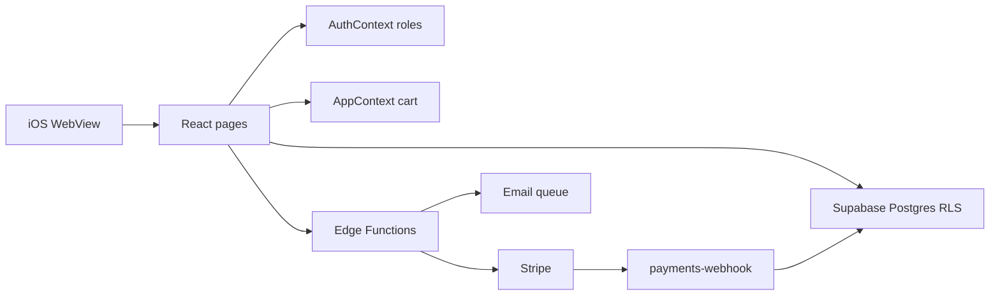

# Champa IT — Architecture

Champa Private Enterprise is a **single-merchant** storefront and IT services desk: hardware catalog and cart, Stripe Checkout, live support chat, customer profile, and an admin portal. It is one merchant of record (no Stripe Connect / multi-seller marketplace). Services (quotes, bookings, invoices) are a separate domain from the product catalog; several of those surfaces are still placeholders.

## Goals

- Long-lived, maintainable structure: clear folder ownership, small pages, shared primitives only where reused.
- Scalable data access: Postgres + RLS for tenant-safe reads/writes; privileged work in Edge Functions.
- Solid mobile shell: Capacitor iOS WebView with CSS safe-area ownership (see [AGENTS.md](../AGENTS.md)).

## Stack

| Layer | Choice |
| --- | --- |
| App shell | Vite + React 18 + TypeScript |
| Routing | `react-router-dom` (`src/App.tsx`) |
| UI | Tailwind CSS + shadcn/ui (`src/components/ui/`) |
| Client state | React context: auth, cart, language |
| Server state | Direct Supabase client queries from pages (React Query provider is present for future use) |
| Backend | Supabase Auth, Postgres, Realtime, Storage, Edge Functions (Deno) |
| Payments | Stripe Checkout + webhook (platform account only) |
| Native | Capacitor 8 iOS (`npm run ios:sync`) |

## Runtime



- **Postgres** is the system of record for catalog, orders, chat, roles, notifications, and CMS-style `settings`.
- **Stripe** is the system of record for funds. Payment status on `orders` is updated by `payments-webhook`, not by the browser.
- The **anon key** ships in the client (including the iOS WebView). Treat every table the client can touch as needing RLS.

## Folder ownership

```
src/
  App.tsx                 # Route table only
  main.tsx                # Bootstrap + native init
  pages/                  # Customer screens (one file ≈ one route)
  pages/admin/            # Admin screens
  components/             # App-specific UI (Layout, ChatWidget, checkout, …)
  components/ui/          # shadcn primitives — do not customize for product logic
  context/                # Auth, cart (AppContext), i18n
  hooks/                  # Shared hooks only when two+ screens need the same logic
  lib/                    # Pure helpers (currency, native, stripe client helpers)
  integrations/supabase/  # Typed client + generated Database types
  types/                  # Shared domain TypeScript types
  data/                   # Local/mock fixtures (legacy; prefer DB)
  assets/                 # Static images
supabase/
  migrations/             # Append-only SQL + RLS
  functions/              # Edge Functions (secrets stay here)
  functions/_shared/      # Stripe helper, email templates
ios/                      # Capacitor native project
docs/                     # Architecture, principles, feature map
```

## Roles

Defined in `user_roles` and loaded by [`src/context/AuthContext.tsx`](../src/context/AuthContext.tsx):

| Role | Access |
| --- | --- |
| `customer` | Storefront, cart, orders, chat, profile |
| `pending_admin` | Signed up requesting admin; routed to `/pending-approval` |
| `approved_admin` | Admin portal (except Admin Management) |
| `super_admin` | Full admin including `/admin/admins` |

Guards: [`src/components/ProtectedRoute.tsx`](../src/components/ProtectedRoute.tsx).

## Data model (public tables)

| Table | Purpose |
| --- | --- |
| `products` | Catalog |
| `orders` | Cart checkouts (items JSON, payment + fulfillment status, guest fields) |
| `profiles` | User profile fields |
| `user_roles` | Role assignments |
| `admin_requests` / `admin_invites` | Admin onboarding |
| `audit_logs` | Admin actions |
| `chat_conversations` / `chat_messages` | Support chat |
| `notifications` | In-app notifications |
| `settings` | Key/value CMS (hero slides, payment info, chat greeting, …) |
| `email_send_log` / `email_send_state` / `email_unsubscribe_tokens` / `suppressed_emails` | Transactional email infra |

Generated types: [`src/integrations/supabase/types.ts`](../src/integrations/supabase/types.ts) — look up a single table; do not read the whole file.

## Edge Functions

| Function | Responsibility |
| --- | --- |
| `create-checkout` | Create Stripe Checkout session for an order |
| `payments-webhook` | Verify Stripe events; update order payment state |
| `send-transactional-email` | Enqueue/send templated mail |
| `process-email-queue` | Drain email queue |
| `auth-email-hook` | Auth-related email hook |
| `handle-email-unsubscribe` / `handle-email-suppression` | Preference / bounce handling |
| `preview-transactional-email` | Template preview |
| `delete-account` | Apple Guideline 5.1.1 in-app account deletion |

Shared: [`supabase/functions/_shared/stripe.ts`](../supabase/functions/_shared/stripe.ts), email templates under `_shared/transactional-email-templates/` (register in `registry.ts`).

## Routes

Declared in [`src/App.tsx`](../src/App.tsx).

### Auth

- `/auth`, `/reset-password`, `/pending-approval`

### Customer (wrapped in `Layout`)

- `/` home (`About`), `/shop`, `/shop/:id`, `/cart`, `/checkout/return`
- `/services`, `/chat`, `/contact`, `/notifications`
- `/profile`, `/profile/orders`, `/profile/orders/:id`, `/profile/settings`, `/profile/saved`, `/profile/faq`
- Placeholders: `/profile/quotes`, `/profile/service-requests`, `/profile/billing` (`ComingSoon`)
- `/unsubscribe`, `*` → `NotFound`

### Admin (wrapped in `AdminLayout` + `ProtectedRoute`)

- `/admin`, `/admin/products`, `/admin/orders`, `/admin/messages`, `/admin/notifications`, `/admin/settings`
- `/admin/admins` — `super_admin` only

## Domains

| Domain | Status |
| --- | --- |
| Catalog + cart + Stripe pay | Live |
| Orders (customer + admin) | Live |
| Chat + notifications | Live |
| Auth / roles / admin management | Live |
| Settings CMS | Live |
| Services request wizard | UI only (toast; not persisted) |
| Quotes / service requests / billing | Coming soon routes |

For file-level owners of each domain, see [FEATURE_MAP.md](FEATURE_MAP.md).

## Related docs

- [CODING_PRINCIPLES.md](CODING_PRINCIPLES.md) — how to add code without eroding structure
- [FEATURE_MAP.md](FEATURE_MAP.md) — where to change things for each feature
- [AGENTS.md](../AGENTS.md) — iOS safe-area and TestFlight QA
